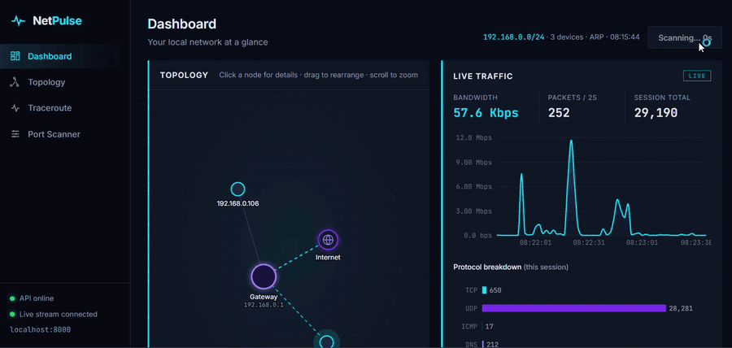
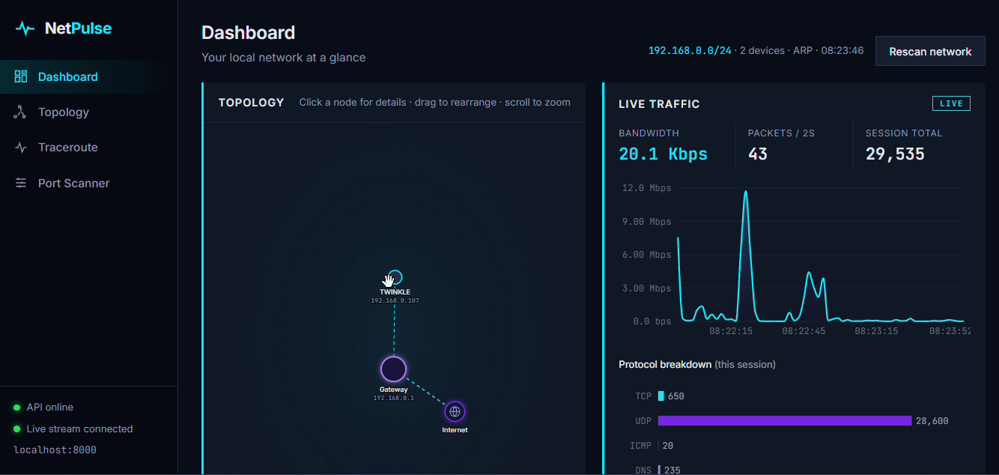
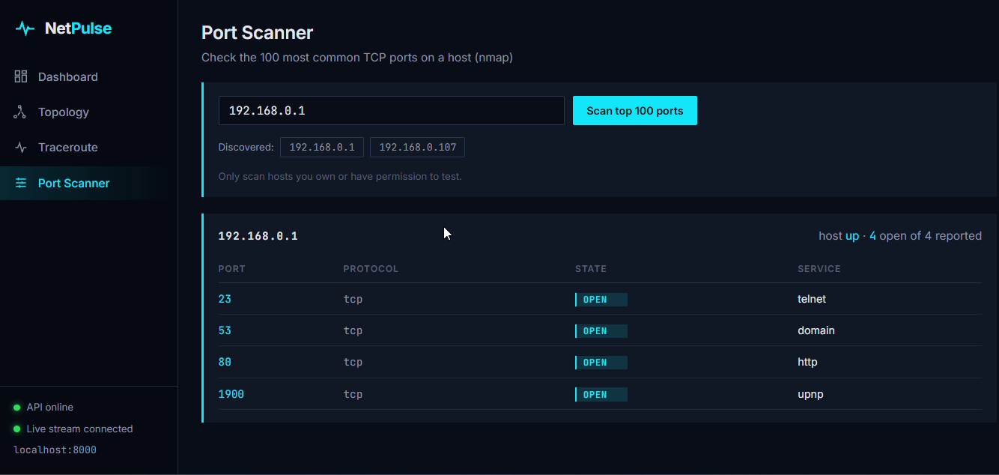

<h1 align="center">NetPulse</h1>

<p align="center"><strong>See your network. Understand your traffic.</strong></p>

<p align="center">
  
  
  
  
  
  <a href="LICENSE"></a>
</p>

NetPulse is a real-time network topology visualizer and analyzer. It discovers the devices on your LAN, maps them as a live force-directed graph, scans their open ports, traces the route your packets take across the internet hop by hop, and streams live traffic statistics to a dashboard.



<sub>The traceroute wait is sped up in this GIF. 🎬 [Download the full demo video (MP4, 1 min)](docs/screenshots/LiveDemo.mp4)</sub>

## Features

- **Device discovery:** ARP-scans the local subnet for each device's IP, MAC and hostname. Falls back to an ICMP ping sweep when raw sockets aren't available.
- **Live topology graph:** a D3.js force-directed map of your LAN. Drag, zoom, and click a device for details, and devices pulse when they show up in live traffic.
- **Real-time traffic monitor:** packet capture with Scapy, streamed over WebSocket every 2 seconds: bandwidth, protocol breakdown (TCP/UDP/ICMP/DNS/HTTP) and top talkers.
- **Streaming traceroute:** TTL-based probing, with hops streamed to the UI as each router answers. Every hop is geolocated and drawn on a world map with animated arcs.
- **Port scanner:** an nmap scan of the 100 most common TCP ports, with color-coded results. IPs are validated before any request is sent.
- **Resilient UI:** skeleton loaders on every request, a step-by-step traceroute progress indicator, and an offline banner that recovers on its own when the backend comes back.
- **Privilege-aware fallbacks:** works without root or admin where possible (ping sweep, system `traceroute`), with clear errors where it can't.
- **One-command startup:** `docker-compose up --build`, or `python run.py` without Docker.

## Architecture

```
[React UI] <──REST / WebSocket──> [FastAPI] <──packets / syscalls──> [Scapy / Nmap / Socket]
```

```
┌──────────────────────────────────────────────────┐
│  React UI          Vite · D3.js · Recharts       │  :3000 (Docker) / :5173 (dev)
│  Dashboard · Topology · Traceroute · Ports       │
└──────────────┬────────────────────────▲──────────┘
  REST (axios) │                        │ WebSocket
  scan · ports │                        │ /ws/traffic     (stats every 2s)
               ▼                        │ /ws/traceroute  (hop by hop)
┌───────────────────────────────────────┴──────────┐
│  FastAPI   (uvicorn, async)                      │  :8000
│  scanner · port_scanner · traceroute · traffic   │
│  blocking network work runs in worker threads    │
└───────┬──────────────────┬──────────────────┬────┘
        ▼                  ▼                  ▼
┌───────────────┐  ┌───────────────┐  ┌──────────────────┐
│    Scapy      │  │     Nmap      │  │     Socket       │
│ ARP scan      │  │ top-100 TCP   │  │ reverse DNS      │
│ ICMP TTL      │  │ port scan     │  │ ping / tracert   │
│ sniffing      │  │               │  │ fallbacks        │
└───────────────┘  └───────────────┘  └──────────────────┘
                                              │
                                     ip-api.com (hop geolocation)
```

## Quick start

```bash
git clone https://github.com/tanmayeechanda/NetPulse.git
cd NetPulse
cp .env.example .env        # optional: every setting has a default
docker-compose up --build
```

Open **http://localhost:3000**. The API runs on **http://localhost:8000**, with interactive docs at `/docs`.

> **Windows / macOS:** Docker Desktop runs containers inside a virtual machine, so discovery and packet capture see that VM's network instead of your Wi-Fi. Turn on **Settings → Resources → Network → Enable host networking** to reach the API, or, for real LAN data, run natively instead:
>
> ```bash
> python run.py
> ```
>
> This installs any missing dependencies, starts the backend (:8000) and frontend (:5173), and opens your browser. It needs Python 3.10+, Node.js 18+, [nmap](https://nmap.org/download) and, on Windows, [Npcap](https://npcap.com). Options: `--no-browser`, `--skip-install`, `--reinstall`.

## Screenshots

| Dashboard | Topology |
|---|---|
| [](docs/screenshots/dashboard.png) | [](docs/screenshots/topology.png) |
| **Live overview:** the topology graph, real-time bandwidth, protocol breakdown and discovered devices | **Force-directed LAN map:** click a device for its details, or jump to a port scan or traceroute |

| Traceroute | Port Scanner |
|---|---|
| [](docs/screenshots/traceroute.png) | [](docs/screenshots/ports.png) |
| **Route map:** each hop is geolocated and joined by animated arcs, with RTT per hop | **nmap top-100 scan:** color-coded results, with one-click scans of discovered devices |

<sub>Captured live from a real home network.</sub>

## Tech stack

| Layer | Technology |
|---|---|
| Backend | Python 3.11, FastAPI, uvicorn, WebSockets |
| Networking | Scapy (ARP, ICMP, sniffing), python-nmap, sockets, ip-api.com |
| Frontend | React 18, Vite, React Router, D3.js (graph + world map), Recharts, Axios |
| Delivery | Docker Compose, nginx (serves the production React build) |

## Configuration

Settings come from `.env` (see [`.env.example`](.env.example)). `docker-compose` reads it automatically, and the backend loads it when run natively. Every value is optional.

| Variable | Default | Purpose |
|---|---|---|
| `SCAN_INTERFACE` | auto-detect | Interface for ARP scans and packet capture (`eth0`, `wlan0`, `Wi-Fi`…). An unknown name logs a warning and falls back to auto-detect. |
| `MAX_SCAN_THREADS` | `32` | Worker threads for the ping-sweep fallback and reverse-DNS lookups (1–256) |
| `REACT_APP_API_URL` | `http://localhost:8000` | Where the browser reaches the API. Baked into the frontend build, so rebuild after changing it. |
| `NETPULSE_SUBNET` | auto-detect | Override the subnet to scan, e.g. `192.168.1.0/24` |
| `NMAP_PATH` | `PATH`, then default install folders | Full path to the nmap binary |
| `LOG_LEVEL` | `INFO` | Backend log verbosity |

### Privileges

| Feature | Needs | Without it |
|---|---|---|
| ARP scan, Scapy traceroute | root / `CAP_NET_RAW` (Linux, macOS) or Npcap (Windows) | Ping sweep + OS ARP cache; system `traceroute`/`tracert` |
| Packet capture | Same as above | Returns `503` with an explanation |
| Port scan | nmap installed | Returns `503` with install instructions |

The Docker backend runs with `network_mode: host` and `NET_RAW`/`NET_ADMIN` capabilities, so all features work out of the box on a Linux host.

## API

| Method | Path | Body / Query | Returns |
|---|---|---|---|
| GET | `/api/health` | — | `{status, timestamp}` |
| GET | `/api/scan/network` | `?subnet=` (optional) | `{subnet, method, devices: [{ip, mac, hostname, status}]}` |
| POST | `/api/scan/ports` | `{"ip": "192.168.1.1"}` | `{ip, host_state, ports: [{port, protocol, state, service}]}` |
| POST | `/api/traceroute` | `{"target": "google.com"}` | `{destination_ip, reached, hops: [{hop_number, ip, hostname, rtt_ms, geo}]}` |
| GET | `/api/traffic` | `?duration=10` | `{protocol_counts, top_ips, bandwidth_bps, …}` |
| WS | `/ws/traffic` | — | A `traffic_stats` message every 2 s |
| WS | `/ws/traceroute` | send `{"target", "max_hops"}` | `start` → `hop` (one per hop) → `locating` → `done` events |

Errors: `400` bad input · `503` missing privileges or tools · `504` timeout.

<details>
<summary>Example requests</summary>

```bash
curl http://localhost:8000/api/scan/network
curl -X POST http://localhost:8000/api/scan/ports -H "Content-Type: application/json" -d '{"ip":"192.168.1.1"}'
curl -X POST http://localhost:8000/api/traceroute  -H "Content-Type: application/json" -d '{"target":"google.com"}'
curl "http://localhost:8000/api/traffic?duration=5"
```

```js
// Streaming traceroute from a browser console
const ws = new WebSocket("ws://localhost:8000/ws/traceroute");
ws.onopen = () => ws.send(JSON.stringify({ target: "google.com", max_hops: 30 }));
ws.onmessage = (e) => console.log(JSON.parse(e.data));
```

</details>

## Project structure

```
NetPulse/
├── backend/
│   ├── main.py              # FastAPI app: REST routes + WebSockets
│   ├── scanner.py           # ARP discovery (ping-sweep fallback)
│   ├── port_scanner.py      # nmap top-100 port scan
│   ├── traceroute.py        # streaming TTL traceroute + geolocation
│   ├── traffic_monitor.py   # Scapy sniffer and live stats
│   ├── utils.py             # config, interface resolution, helpers
│   └── Dockerfile
├── frontend/
│   ├── src/
│   │   ├── components/      # TopologyGraph, TrafficChart, TracerouteMap, PortScanner, Skeleton…
│   │   ├── pages/           # Dashboard, Topology, Traceroute, Port Scanner
│   │   ├── context/         # Backend status, network scan, live traffic
│   │   ├── hooks/           # useWebSocket, useElapsed
│   │   └── api.js           # REST + WebSocket client
│   ├── Dockerfile           # Node 20 build → nginx
│   └── nginx.conf
├── docs/                    # Demo GIF, video, screenshots
├── docker-compose.yml
├── .env.example
├── run.py                   # One-command native launcher
└── LICENSE
```

## Troubleshooting

| Symptom | Fix |
|---|---|
| Red **Backend offline** banner | Start the backend (`docker-compose up` or `python run.py`). The UI reconnects on its own. |
| Network scan shows `192.168.65.x` | You're on Docker Desktop, which shows the VM's network. Use `python run.py` for your real LAN. |
| Live traffic says capture isn't permitted | Run as root (Linux/macOS) or install Npcap (Windows). |
| Docker build fails with `"/app/dist": not found` after finishing suspiciously fast | Docker's build cache is corrupted. Run `docker builder prune -af` and rebuild. |
| Port scanner returns `503` | Install nmap, or set `NMAP_PATH`. |

## Contributing

Contributions are welcome!

1. Fork the repo and create a branch: `git checkout -b feature/my-idea`
2. Run the app locally with `python run.py`
3. Make sure the frontend builds: `cd frontend && npm run build`
4. Open a pull request describing what changed and why

Ideas on the roadmap: **LLDP/SNMP** discovery for real switch-to-switch topology, **historical metrics** with latency and packet-loss alerts, IPv6 support, and tests with CI.

Please only scan networks and hosts you own or are explicitly authorized to test.

## License

Released under the [MIT License](LICENSE).
