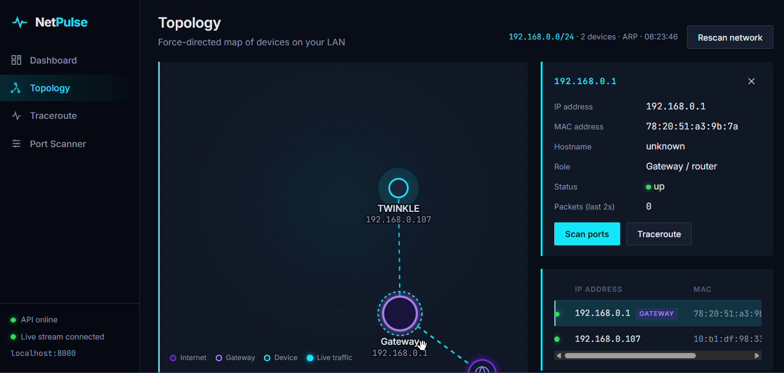
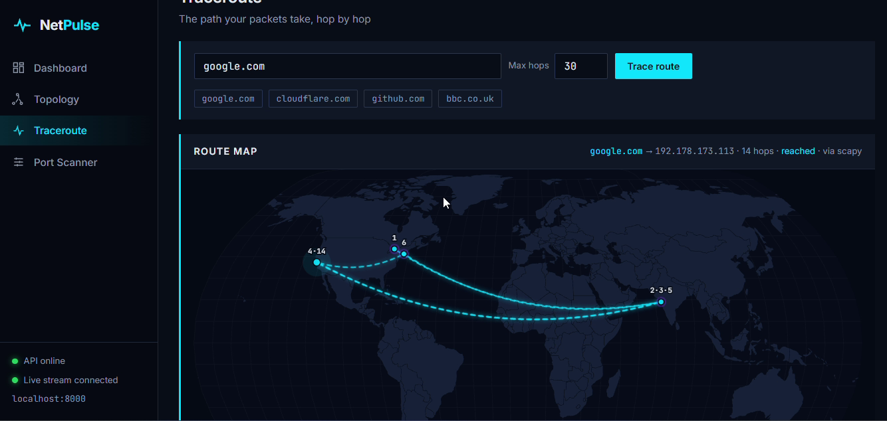

# NetPulse

**Real-Time Network Topology Visualizer & Analyzer**

NetPulse discovers devices on your local network, scans their open ports, traces routes to remote hosts with geolocation for each hop, and monitors live traffic. A Python backend does the network work, and a React dashboard draws it as a live topology graph, traffic charts and a world map.


## Screenshots

| Dashboard | Topology |
|---|---|
| [](docs/screenshots/dashboard.png) | [](docs/screenshots/topology.png) |
| **Live overview:** the topology graph, real-time bandwidth, protocol breakdown and discovered devices | **Force-directed LAN map:** click a device for its details, or jump to a port scan or traceroute |

| Traceroute | Port Scanner |
|---|---|
| [](docs/screenshots/traceroute.png) | [](docs/screenshots/ports.png) |
| **Route map:** each hop is geolocated and joined by animated arcs, with RTT per hop | **nmap top-100 scan:** color-coded results, with one-click scans of discovered devices |

<sub>Captured from a real home network. MAC addresses and hostnames are partially masked.</sub>

## Quick start

From the project folder, run:

```bash
python run.py
```

This one command:

1. installs any missing backend (pip) and frontend (npm) dependencies; this happens only on the first run or after `package-lock.json` changes
2. starts the backend on **http://localhost:8000** and the frontend on **http://localhost:5173**
3. opens the dashboard in your browser once both are ready

Press **Ctrl+C** to stop both servers.

**Prerequisites:** Python 3.10+, Node.js 18+ and, for the Port Scanner, [nmap](https://nmap.org/download). On Windows, also install [Npcap](https://npcap.com) for network discovery and live traffic. See [Privileges and system dependencies](#privileges-and-system-dependencies) for details.

| Option | Effect |
|---|---|
| `--no-browser` | Don't open a browser tab |
| `--skip-install` | Skip the dependency check (faster restarts) |
| `--reinstall` | Force `pip install` and `npm install` |

If the backend is already running on port 8000, `run.py` reuses it and only starts the frontend.

> **Linux/macOS:** ARP scanning and packet capture need root. Use `sudo python3 run.py`, or run without sudo and accept the ping-sweep fallback, which has no live traffic.

## Tech stack

- **Backend:** Python 3.11, FastAPI, WebSockets
- **Networking:** scapy (ARP, ICMP, packet sniffing), python-nmap, ip-api.com for geolocation
- **Frontend:** React 18, Vite, D3.js (topology + world map), Recharts (traffic charts)
- **Deployment:** Docker Compose

## Project layout

```
NetPulse/
├── backend/
│   ├── main.py              # FastAPI app + routes + WebSocket
│   ├── scanner.py           # ARP network discovery (ping-sweep fallback)
│   ├── port_scanner.py      # nmap top-100 port scan
│   ├── traceroute.py        # scapy traceroute + ip-api.com geolocation
│   ├── traffic_monitor.py   # scapy packet sniffer and stats
│   ├── utils.py             # shared helpers
│   ├── requirements.txt
│   └── Dockerfile
├── frontend/
│   ├── src/
│   │   ├── components/      # TopologyGraph, TrafficChart, TracerouteMap, PortScanner, DeviceTable, Sidebar
│   │   ├── pages/           # Dashboard, Topology, TraceroutePage, PortScanPage
│   │   ├── context/         # Shared network-scan and live-traffic state
│   │   ├── hooks/           # useWebSocket, useElapsed
│   │   ├── api.js           # Axios client for the backend
│   │   └── index.css        # Design system (CSS variables)
│   ├── Dockerfile           # Node 20 build → nginx
│   └── nginx.conf
├── docs/                    # README screenshots and demo GIF
├── docker-compose.yml
├── run.py                   # One-command launcher (backend + frontend)
└── README.md
```

## API

| Method | Path | Body / Query | Returns |
|---|---|---|---|
| GET | `/api/health` | — | `{status: "ok", timestamp}` |
| GET | `/api/scan/network` | `?subnet=192.168.1.0/24` (optional) | `{subnet, method, count, devices: [{ip, mac, hostname, status}]}` |
| POST | `/api/scan/ports` | `{"ip": "192.168.1.1"}` | `{ip, host_state, ports: [{port, protocol, state, service}]}` |
| POST | `/api/traceroute` | `{"target": "google.com"}` | `{destination_ip, reached, hops: [{hop_number, ip, hostname, rtt_ms, geo: {lat, lon, city, country}}]}` |
| GET | `/api/traffic` | `?duration=10` (1–120 s) | `{protocol_counts: {TCP, UDP, ICMP, DNS, HTTP, OTHER}, top_ips: [{ip, packet_count}], bandwidth_bps, ...}` |
| WS | `/ws/traffic` | — | A `traffic_stats` message every 2 s, in the same shape as `/api/traffic` |

Interactive docs are at **http://localhost:8000/docs** while the server runs.

Error codes: `400` for bad input, `503` when the operation needs privileges or tools that are missing (root, Npcap, nmap), `504` on timeout.

> **Protocol counts:** DNS and HTTP are application-layer tags, so a DNS packet is counted under both `UDP` and `DNS`. HTTP is detected by port (80/8000/8080) or by a request/response line in the payload. HTTPS traffic is encrypted and counts as `TCP` only.

## Running the backend on its own

`python run.py` is the easiest way to start everything. To start only the backend:

```bash
cd backend
pip install -r requirements.txt
python main.py
```

Then check http://localhost:8000/api/health.

### Privileges and system dependencies

| Feature | Requirement |
|---|---|
| ARP scan, scapy traceroute, packet capture | **Linux/macOS:** run as root (`sudo python main.py`) or grant `CAP_NET_RAW`. **Windows:** install [Npcap](https://npcap.com) and run the terminal as Administrator. |
| Port scan | [nmap](https://nmap.org/download) must be installed. It's found on `PATH`, in the default install folders, or via `NMAP_PATH`. |

The app falls back when it lacks privileges. Network discovery switches to a ping sweep that reads MACs from the OS ARP cache, and traceroute calls the system `tracert`/`traceroute`. Packet capture has no fallback and returns `503`.

### Environment variables (optional, `.env` supported)

| Var | Default | Purpose |
|---|---|---|
| `PORT` / `HOST` | `8000` / `0.0.0.0` | Bind address |
| `NETPULSE_SUBNET` | auto-detected | Subnet to scan |
| `NETPULSE_IFACE` | scapy default | Interface to sniff on |
| `NMAP_PATH` | PATH, then default install dirs | Full path to the nmap binary |
| `LOG_LEVEL` | `INFO` | Logging verbosity |
| `RELOAD` | `false` | uvicorn auto-reload |

## Frontend

| Page | What it shows |
|---|---|
| **Dashboard** | Topology graph (left half), live traffic chart and device table (right) |
| **Topology** | Full force-directed graph. Click a node for details, port scan or traceroute |
| **Traceroute** | World map with animated hop-to-hop route lines, plus a hop table with RTT |
| **Port Scanner** | IP input (or pick a discovered device) and a color-coded port table |

Nodes pulse when they appear in the live traffic stream. The network scan runs once on load and is shared across pages; use **Rescan network** to refresh it.

### Run the frontend on its own

`python run.py` starts it for you. To start only the frontend, start the backend first, then:

```bash
cd frontend
npm install
npm run dev
```

Open **http://localhost:5173**. The API address defaults to `http://localhost:8000`; override it with `VITE_API_URL` in `frontend/.env`.

## Running with Docker Compose

Docker is mainly for deploying on a Linux machine. On Windows/macOS, use `python run.py` instead (see the note below).

```bash
docker compose up --build
```

- Frontend: **http://localhost:3000**
- Backend API: **http://localhost:8000**

The container uses `network_mode: host` and adds `NET_RAW`/`NET_ADMIN` so it can see real interfaces for ARP scans and sniffing. Host networking only works fully on **Linux** hosts. On Docker Desktop (Windows/macOS) the container sees the VM's network, not your LAN.

> **Troubleshooting:** a build may finish suspiciously fast and then fail with `"/app/dist": not found`. That means Docker's build cache is corrupted (this can happen after Docker Desktop hangs). Run `docker builder prune -af` and build again.

## Examples

```bash
curl http://localhost:8000/api/scan/network
curl -X POST http://localhost:8000/api/scan/ports -H "Content-Type: application/json" -d '{"ip":"192.168.1.1"}'
curl -X POST http://localhost:8000/api/traceroute  -H "Content-Type: application/json" -d '{"target":"google.com"}'
curl "http://localhost:8000/api/traffic?duration=5"
```

WebSocket (in a browser console):

```js
const ws = new WebSocket("ws://localhost:8000/ws/traffic");
ws.onmessage = (e) => console.log(JSON.parse(e.data));
```

## Legal

Only scan networks and hosts you own or are explicitly authorized to test.

## Roadmap

- [x] Phase 1: FastAPI backend (discovery, ports, traceroute, traffic, live WebSocket)
- [x] Phase 2: React + D3.js dashboard (topology, traffic charts, traceroute map, port scanner)
- [ ] Phase 3: Historical metrics and alerting
